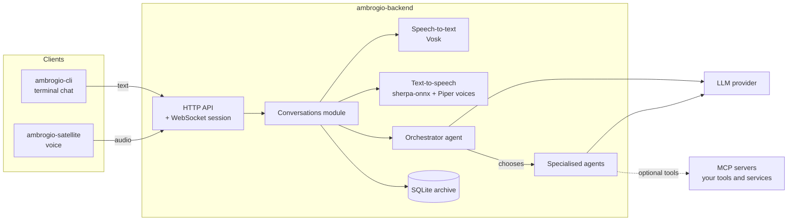
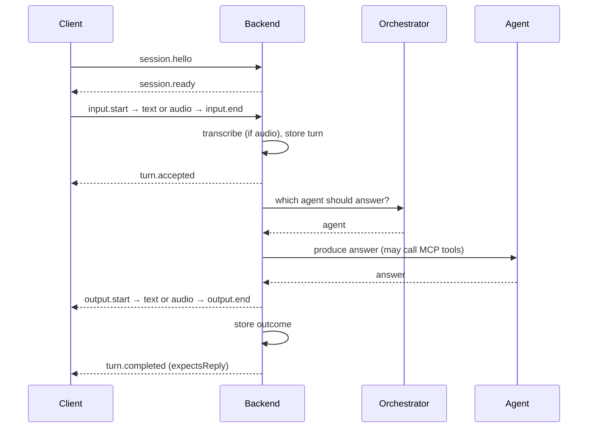

<p align="center">
  <picture>
    <source media="(prefers-color-scheme: dark)" srcset=".github/logo-dark.svg">
    
  </picture>
</p>

# Ambrogio — backend

**Ambrogio** is an open source home assistant that you host yourself, for example in your homelab. Members of the family talk to it by typing or by voice. Ambrogio keeps the conversation history and can hand each request to a specialised AI agent.

This repository holds the **backend**: the server that receives turns from clients, picks an agent and produces the answer. It also stores conversations and turns speech into text and text into speech. It owns the public protocol that every client uses.

| Repository | Role |
|---|---|
| **ambrogio-backend** (this one) | Conversation server, agents, speech, storage, public protocol |
| [ambrogio-cli](https://github.com/ambrogio-app/ambrogio-cli) | Terminal chat client |
| [ambrogio-satellite](https://github.com/ambrogio-app/ambrogio-satellite) | Voice satellite with wake word, microphone and speaker |
| [ambrogio-web](https://github.com/ambrogio-app/ambrogio-web) | Optional web chat client |

> Ambrogio is in early development. Its own messages are in English or Italian, and the configuration format may still change between versions.

## How it works



- **One protocol for text and voice.** Clients open a WebSocket session on `/api/session` with the `ambrogio.v1` subprotocol. One session carries turns for many conversations. A request can be text or 16 kHz PCM audio, and the client chooses whether the answer comes back as text or as audio. The message schema is in [`protocol/ambrogio-v1.schema.json`](protocol/ambrogio-v1.schema.json).
- **Shared conversations.** Every conversation is stored, so any client can continue it. A chat started in the terminal can go on by voice, and the other way round. Plain HTTP endpoints list conversations and return their history.
- **Agents.** For each turn an *orchestrator* chooses which *specialised agent* should answer. It does not answer itself. Each agent has its own instructions and model. An agent can also connect to an [MCP](https://modelcontextprotocol.io/) server and call its tools, for example to reach your home automation or other services.
- **Optional voice.** Speech recognition and synthesis run inside the backend process. No cloud speech service is needed. Text chat works without any voice setup.
- **Reliable turns.** A conversation handles one turn at a time, and separate conversations run in parallel. Once the backend accepts a turn, it finishes and stores that turn even if the client disconnects. Each turn ends with exactly one outcome: completed, failed, rejected or interrupted.

Two base connectors are planned for the first version:

- **Home Assistant**: read the state of your home devices and control them during a conversation.
- **Memory**: answer questions about earlier conversations, both typed and spoken, by retrieving relevant passages from the shared history (RAG). Ambrogio will provide both the MCP client and the MCP server for this connector.

### A turn, step by step



## Dependencies

**Runtime**

- Node.js 24 or later; pnpm to build from source
- Linux, or Docker (the published image is `linux/amd64`)
- An API key for each LLM provider you use. Agents reach Mistral, OpenAI, Anthropic, Google Gemini or any OpenAI-compatible API through the [Vercel AI SDK](https://ai-sdk.dev/). The models must support tool calling and structured JSON output
- For voice only: a [Vosk](https://alphacephei.com/vosk/models) speech model, such as `vosk-model-small-en-us-0.15`, and a voice for the same language. The Docker image already contains two Italian Piper voices; see [`voices/README.md`](voices/README.md)

**Main libraries**

| Area | Library |
|---|---|
| HTTP and WebSocket | Fastify, `@fastify/websocket`, `@fastify/helmet`, `@fastify/cors` |
| Storage | SQLite (`better-sqlite3`) with Kysely |
| Validation | TypeBox, Ajv |
| Agents | Vercel AI SDK (`ai`, `@ai-sdk/mistral`, `@ai-sdk/openai`, `@ai-sdk/anthropic`, `@ai-sdk/google`, `@ai-sdk/openai-compatible`), MCP client |
| Speech | `vosk-koffi` (speech-to-text), `sherpa-onnx-node` (text-to-speech) |
| Logging | Pino, as JSON lines on stdout |

## Quick start

The server reads one small JSON file per component. Configuration files and the database stay outside the image and the repository.

```
/etc/ambrogio/
├── http.json              # listen address, allowed origins, HTTPS flags
├── conversations.json     # SQLite archive path, language, page sizes
├── voice.json             # optional: Vosk model and Piper voice
└── agents/
    ├── orchestrator.json  # chooses the agent for each turn
    └── generic.json       # at least one specialised agent
```

Minimal examples:

```jsonc
// http.json
{ "host": "0.0.0.0", "port": 3000 }

// conversations.json
{ "archivePath": "/data/conversations.sqlite", "language": "en" }

// agents/orchestrator.json
{ "instructions": "You are Ambrogio, the family assistant.",
  "llm": { "provider": "mistral", "model": "mistral-medium-latest", "apiKey": "..." } }

// agents/generic.json
{ "description": "Answers general questions.",
  "instructions": "Answer briefly.",
  "llm": { "provider": "mistral", "model": "mistral-medium-latest", "apiKey": "..." } }
```

Each agent picks its own `provider`: `mistral`, `openai`, `anthropic`, `google` or `openai-compatible`. With `openai-compatible`, add `baseURL`, the address of the API, for example `"baseURL": "http://localhost:11434/v1"`.

**With Docker**

```bash
docker run -d --name ambrogio -p 3000:3000 \
  -v /srv/ambrogio/config:/etc/ambrogio:ro \
  -v /srv/ambrogio/data:/data \
  -e AMBROGIO_HTTP_CONFIG_PATH=/etc/ambrogio/http.json \
  -e AMBROGIO_CONVERSATIONS_CONFIG_PATH=/etc/ambrogio/conversations.json \
  ghcr.io/ambrogio-app/ambrogio-backend:<version>
```

Versioned images are published on GHCR for every `vX.Y.Z` tag. There is no `latest` tag.

**From source**

```bash
pnpm install --frozen-lockfile
pnpm build
AMBROGIO_HTTP_CONFIG_PATH=/etc/ambrogio/http.json \
AMBROGIO_CONVERSATIONS_CONFIG_PATH=/etc/ambrogio/conversations.json \
node apps/server/dist/main.js
```

To enable voice, set `AMBROGIO_VOICE_CONFIG_PATH` to a JSON file that contains `voskModelPath`, `voiceEngine` (`piper` or `kokoro`) and `voiceModelDir`, plus, with Kokoro, `voiceSpeaker` (the numeric ID of the voice in the model) and `voiceLanguage` (an espeak-ng language code such as `it`, `en` or `pt-br`). Any Kokoro model from the sherpa-onnx `tts-models` release can be used; none is bundled, and Kokoro needs a faster CPU than the Piper voices.

If the server cannot start, it writes one JSON line with `"event":"server_startup_failed"` to stdout, whose `err.message` names the cause (for example `Invalid agent configuration: general` or `Agent MCP connection failed: home-assistant`), then prints `Unable to start HTTP server.` to stderr and exits with code 1.

**Home Assistant.** [`examples/agents/home-assistant.json`](examples/agents/home-assistant.json) is a ready agent for Home Assistant's [Model Context Protocol Server](https://www.home-assistant.io/integrations/mcp_server/) integration. Copy it to `/etc/ambrogio/agents/`, then replace the address, `<MISTRAL_API_KEY>` and `<HOME_ASSISTANT_LONG_LIVED_ACCESS_TOKEN>` (a long-lived access token created in your Home Assistant profile). Only the entities exposed to Assist are available to Ambrogio.

> Ambrogio has no user accounts or authentication. Run it on a trusted network, or behind a reverse proxy that allows only your own clients.

## Repository layout

```
apps/server/              runnable server: runtime, composition, entry point
packages/conversations/   "Conversations" business module (domain, application, adapters)
protocol/                 JSON schema of the ambrogio.v1 protocol
examples/                 ready configuration files, with placeholder credentials
voices/                   provenance of the bundled Piper voices
system-model/             engineering model (requirements, contracts, verifications)
```

The code follows a ports-and-adapters design. Domain and application logic do not depend on Node.js or on external libraries; adapters connect them to HTTP, SQLite, the LLM provider and the speech engines.

## Development

```bash
pnpm test        # Vitest suite, including real SQLite adapters
pnpm typecheck
pnpm build
```

Secrets must never enter the history. CI scans the whole history with [gitleaks](https://github.com/gitleaks/gitleaks) 8.30.1 on every push and pull request, and no image is published if the scan fails. Locally, a versioned pre-commit hook runs gitleaks on staged changes. Install gitleaks 8.30.1 on your `PATH` and enable the hook once per clone:

```bash
git config core.hooksPath .githooks
```

Ambrogio is developed model first with [Reqvire](https://reqvire.org/). Capabilities, requirements, contracts and verifications live in [`system-model/`](system-model/) and are recorded before the code changes. [`AGENTS.md`](AGENTS.md) describes the workflow.

## License

[MIT](LICENSE). The bundled voice models have their own licenses; see [`voices/README.md`](voices/README.md).
